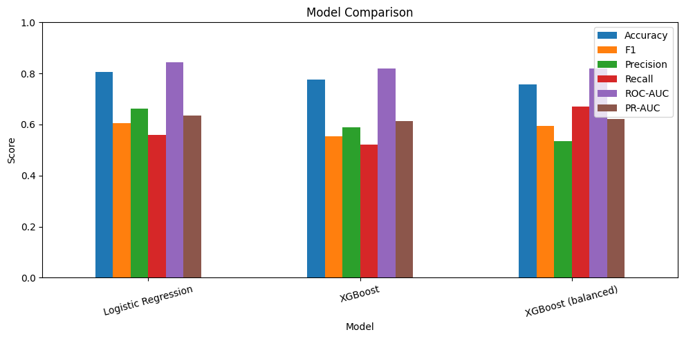

# Customer Churn Prediction & Retention Prioritization

Churn prediction on the IBM Telco dataset, with a simple cost-benefit layer 
to rank customers by expected retention value under a limited budget.

## Dataset

IBM Telco Customer Churn — ~7,000 rows, 21 columns. Target is `Churn` (Yes/No).
The data is imbalanced: about 73% of customers did not churn.

## Preprocessing

- `TotalCharges` was stored as text with blank values. Converted to numeric 
  and filled blanks with 0.
- Dropped `customerID`.
- One-hot encoded all categorical columns (`pd.get_dummies(drop_first=True)`).
  Label encoding was avoided because it would impose a false numeric order 
  on things like contract type.
- Split 80/20 with stratification so the churn ratio stays the same in train 
  and test.

## Results

| Model | Accuracy | F1 | Precision | Recall | ROC-AUC | PR-AUC |
|---|---|---|---|---|---|---|
| Logistic Regression | 0.807 | 0.606 | 0.661 | 0.559 | 0.842 | 0.634 |
| XGBoost | 0.776 | 0.553 | 0.589 | 0.521 | 0.818 | 0.614 |
| XGBoost (balanced) | 0.757 | 0.595 | 0.534 | 0.671 | 0.819 | 0.621 |

Logistic Regression performed best on 5 of 6 metrics. XGBoost did not beat it 
in these experiments. Possible reasons include dataset size, feature 
relationships, preprocessing choices, and hyperparameter settings — this was 
not investigated further.

Balanced XGBoost achieved the highest recall (0.671) but the lowest precision 
(0.534): it catches more churners at the cost of more false alarms.

Top features from XGBoost: `InternetService_Fiber optic` (0.43), 
`Contract_Two year` (0.17), `Contract_One year` (0.09), 
`InternetService_No` (0.08), `tenure` (0.02).

## Business impact

A prediction of "this customer will churn" is not useful on its own. The real 
question is: with a limited budget, who should we contact first?

I added a simplified retention-value model:
- Assumed retention offer cost: ₹500 per customer
- Assumed customer lifetime value: ₹2,000
- Expected value = P(churn) × 2000 − 500

Targeting the top 10% of customers by model score produced an estimated net 
value of ₹133,411, compared to an average of ₹4,912 for random targeting 
(averaged over 100 random draws). This is a **difference of ₹128,500** under 
the stated assumptions.

Lift@10% = **2.83x**: customers in the top 10% by model score churn at 2.83 
times the overall rate (75% vs 26.5% in the test set).

These numbers depend heavily on the ₹500 / ₹2,000 assumptions, and the model 
assumes that a retention offer always succeeds. The relative difference 
(model vs random) is the meaningful result, not the absolute rupee figure.

## What this model cannot do

- F1 is around 0.6, meaning many actual churners are missed. In production you 
  would want a cost-sensitive threshold, not the default 0.5 cutoff.
- The ₹500 / ₹2,000 values are assumptions, not real business data.
- The model assumes retention offers always work. A better version would use 
  uplift modeling to estimate who actually responds to an offer, not just who 
  is likely to churn.
- If the company changes its churn definition (e.g., 3 months instead of 1), 
  the model must be retrained.
- One-hot encoding was used for all models. For XGBoost, other categorical 
  encodings may perform differently and were not tested.

## Tech stack

Python, Pandas, Scikit-learn, XGBoost, Matplotlib.

## Files

- `churn_prediction.ipynb` — full notebook
- `model_comparison.png` — metric comparison chart
- `README.md` — this file
